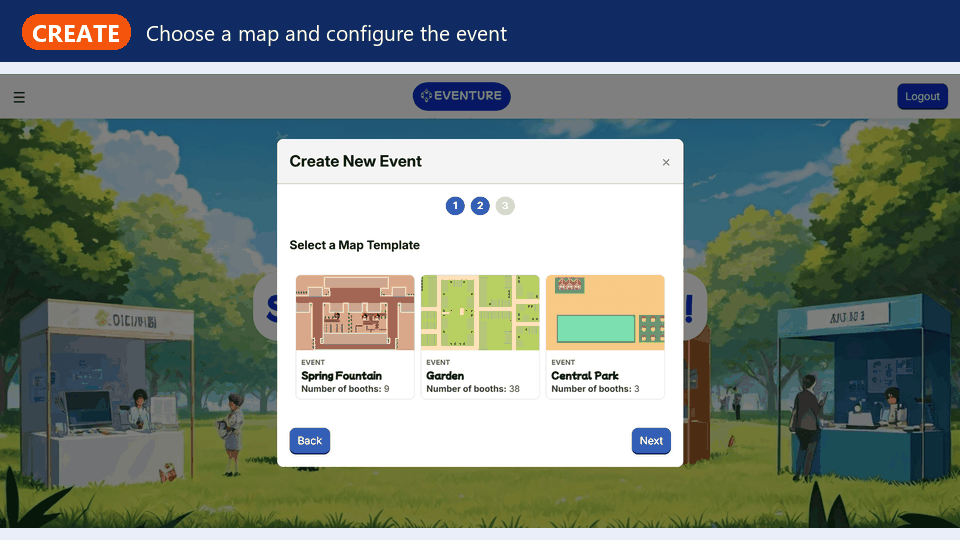
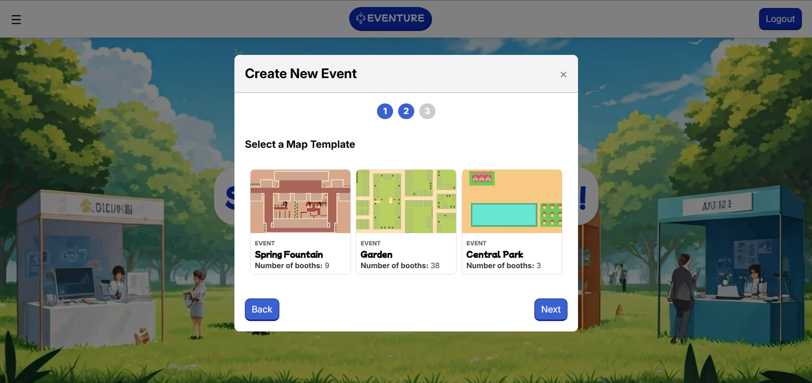
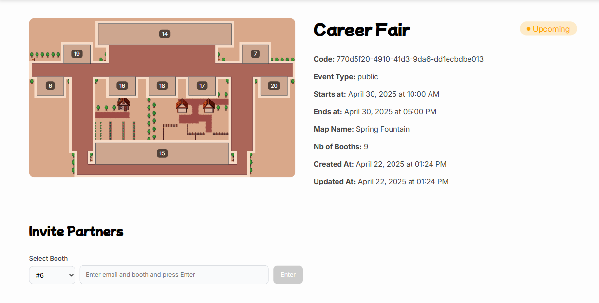
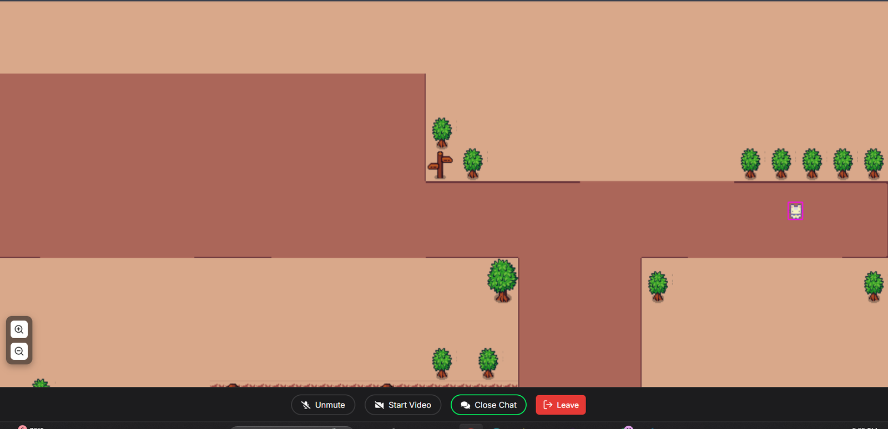
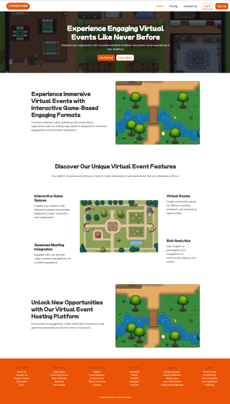
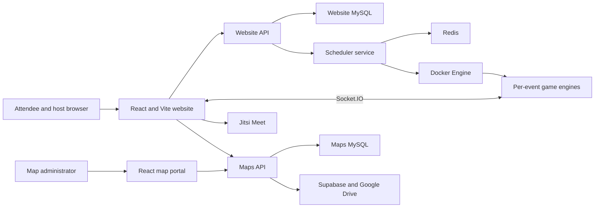
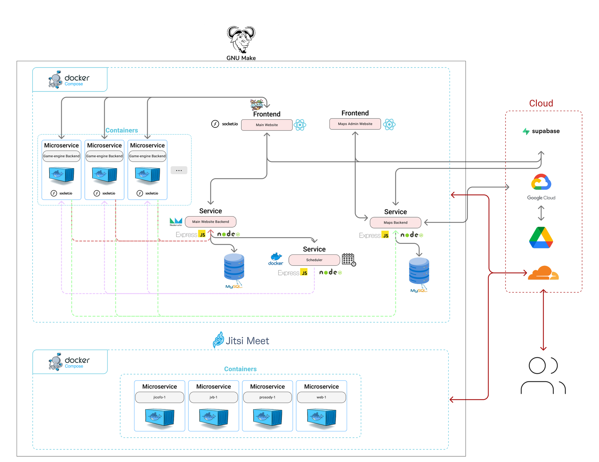

<div align="center">

# Eventure

**A game-like virtual event platform for career fairs, expos, and live networking.**

[](https://react.dev/)
[](https://phaser.io/)
[](https://nodejs.org/)
[](https://socket.io/)
[](https://docs.docker.com/compose/)
[](https://www.mysql.com/)

<br />



</div>

## Overview

Eventure turns a conventional online event into a shared, explorable world. Hosts create public or private events, choose a map, configure booths, and invite partner organizations. Attendees move through the venue as avatars, see other participants in real time, and enter booth-specific Jitsi rooms for face-to-face conversations.

The project is a Docker-based service architecture with separate experiences for attendees, hosts, and map administrators. A scheduler coordinates event lifecycles and launches isolated Socket.IO game-engine containers for active events.

## Product tour

<table>
  <tr>
    <th width="33%">Create an event</th>
    <th width="33%">Prepare the venue</th>
    <th width="33%">Explore and meet</th>
  </tr>
  <tr>
    <td></td>
    <td></td>
    <td></td>
  </tr>
  <tr>
    <td>Choose a map template and configure the event through a guided flow.</td>
    <td>Review venue details, assign booths, and invite partner organizations.</td>
    <td>Move through the shared world and join live conversations at booths.</td>
  </tr>
</table>

<details>
  <summary>View the public landing experience</summary>
  <p align="center">
    <br />
    
  </p>
</details>

## Core capabilities

### For hosts

- Create public or private events and track upcoming, active, and completed events.
- Select reusable map templates with different booth capacities and layouts.
- Assign booths, invite partner organizations by email, and share event links.
- Review event details, dates, access information, map previews, and partner status.
- Let the scheduler start and stop an event-specific game server automatically.

### For attendees and partners

- Register or sign in through role-aware user and host portals.
- Discover public events or join private events through invitation flows.
- Navigate a Phaser-powered venue as an avatar and see participant movement in real time.
- Enter and leave booth zones, with presence synchronized over Socket.IO.
- Join embedded Jitsi meetings for live audio, video, and chat.
- Accept booth invitations and manage events in which the organization is participating.

### For map administrators

- Create, update, delete, and publish reusable venue templates.
- Upload Tiled map layers, collision data, tilesets, character assets, and thumbnails.
- Store map packages through Google Drive and serve preview images through Supabase Storage.
- Mark the latest map versions available to the event-creation workflow.

## How an event works

1. A host creates an event, selects a map, and assigns its booths.
2. The host invites partners and shares public or private attendee access.
3. At the scheduled start time, the scheduler launches a dedicated game-engine container.
4. Participants join the map, synchronize movement through Socket.IO, and enter Jitsi rooms at booth interaction zones.

## Architecture



The website API owns accounts, authentication, subscriptions, events, invitations, partners, and booth assignments. The maps service manages versioned venue assets. Redis supports scheduling state, while the scheduler uses the Docker socket to create a dedicated real-time game service for each running event. Jitsi runs as its own container stack.

<details>
  <summary>View the detailed system diagram</summary>
  <p align="center">
    <br />
    
  </p>
</details>

## Technology stack

| Area | Technology |
| --- | --- |
| Main web app | React 19, Vite 6, React Router, styled-components |
| Interactive venue | Phaser 3, Socket.IO |
| Video meetings | Jitsi React SDK and self-hosted Jitsi Meet |
| APIs | Node.js, Express, TypeScript |
| Data | MySQL 8, Sequelize, Redis |
| Map pipeline | Tiled assets, Google Drive, Supabase Storage, Sharp |
| Email | Nodemailer invitations |
| Runtime | Docker, Docker Compose, GNU Make |

## Repository layout

| Path | Purpose |
| --- | --- |
| `Website/frontend` | Public site plus attendee and host portals |
| `Website/backend` | Authentication, events, invitations, partners, booths, and subscriptions |
| `Maps/frontend` | Map-administration interface |
| `Maps/backend` | Map upload, versioning, packaging, and storage integrations |
| `Game-engine/backend` | Per-event Socket.IO presence and booth-interaction server |
| `Scheduler/backend` | Event lifecycle scheduling and game-container orchestration |
| `Tiled maps` | Example TMX/TSX venue maps, tilesets, and collision assets |
| `dump` | MySQL initialization dumps for local development |
| `docker-jitsi-meet-stable-10184` | Self-hosted Jitsi Meet container stack |

## Local development

### Prerequisites

- Git
- Docker Desktop or Docker Engine with Compose
- GNU Make and a Bash-capable shell
- Supabase project and storage buckets
- Google OAuth and Drive credentials for map storage
- An SMTP-capable mailbox for invitation emails
- A public HTTPS domain for Jitsi, such as a Cloudflare Tunnel hostname

Chrome and Edge are the currently documented browsers for the project.

### 1. Clone and configure

```bash
git clone https://github.com/maysam-mtr/event-hosting-platform.git
cd event-hosting-platform
cp .env.example .env
```

PowerShell equivalent:

```powershell
Copy-Item .env.example .env
```

Replace every sample credential in `.env` before starting the stack. In particular, configure the database, JWT and cookie settings, service ports and URLs, Supabase, Google Drive, invitation email, Jitsi domain, and game-engine image name. Never commit `.env` or production secrets.

### 2. Start the complete platform

```bash
make run-whole-project
```

This command configures the Jitsi stack, builds the reusable game-engine image, and starts the Eventure services with Docker Compose.

To run the stages separately:

```bash
make set-up-jitsi
make build-game-engine
make set-up-eventure
```

### 3. Open the local services

| Service | URL |
| --- | --- |
| Eventure website | <http://localhost:5173> |
| Website API | <http://localhost:5000> |
| Maps admin | <http://localhost:5777> |
| Maps API | <http://localhost:3000> |
| Scheduler API | <http://localhost:3333> |

Jitsi is available through the HTTPS hostname configured in `JITSI_DOMAIN`. Game-engine containers are created for individual events by the scheduler.

## Development checks

Each service owns its dependencies and scripts; there is no root Node workspace. Run checks from the package you changed.

| Package | Commands |
| --- | --- |
| `Website/frontend` | `npm run lint`, `npm run build` |
| `Maps/frontend` | `npm run lint`, `npm run build` |
| `Website/backend` | `npm run build` |
| `Maps/backend` | `npm run build` |

The game engine and scheduler currently expose development scripts but do not define automated test suites.

## Security and operational notes

- Use unique, randomly generated JWT secrets and rotate any credential that has ever been committed or shared.
- The scheduler mounts the Docker socket so it can launch game servers. Treat it as a trusted internal service and do not expose it directly to the internet.
- The bundled MySQL services use temporary filesystems and initialize from `dump/`; local database state is disposable when containers are recreated.
- Production deployments should use managed secrets, persistent databases, restricted service networking, TLS, backups, and hardened Jitsi configuration.

---

<div align="center">
Built to make online events feel like places people can explore together.
</div>
